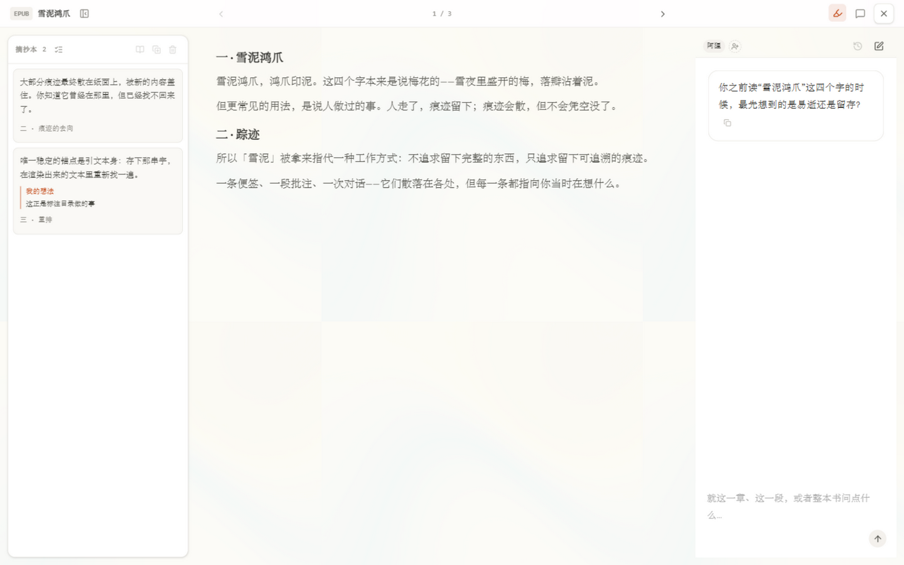
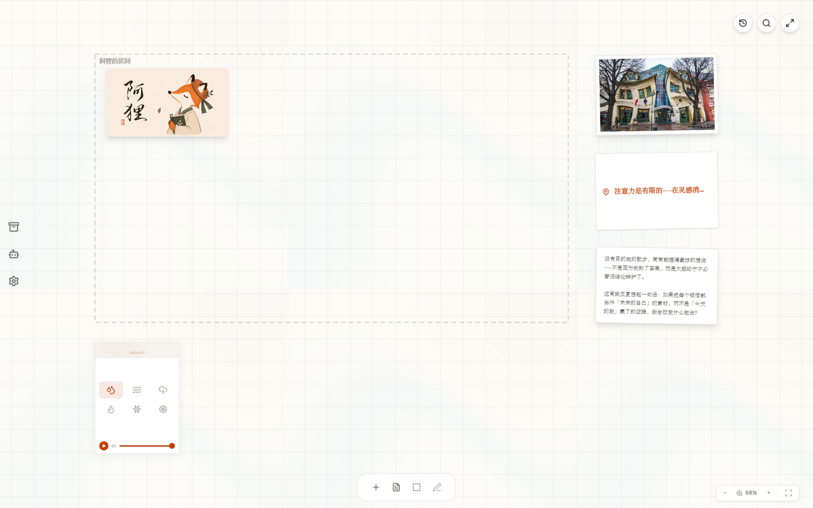

<div align="center">


# Spoor

**A local-first spatial notes canvas with AI personas.**

Place notes, screenshots, documents, research findings, and AI responses on one infinite canvas. Then use different AI personas to question, connect, rewrite, and research your ideas.

[](https://scribe-ai-canvas.netlify.app/)
[](https://github.com/iimorning/spoor/releases/latest)
[](LICENSE)

[Live Demo](https://scribe-ai-canvas.netlify.app/) · [Windows Release](https://github.com/iimorning/spoor/releases/latest) · [Issues](https://github.com/iimorning/spoor/issues)

<p align="center">
  
</p>

*The reading view — excerpts on the left, the book in the middle, the companion on the right.*

</div>

---

## What It Does

- **Infinite canvas notes** — arrange ideas spatially instead of burying them in folders or chat history.
- **AI personas on the canvas** — use different agents for critique, synthesis, language exploration, and future scenarios.
- **Context-aware AI notes** — select notes, ask an agent to analyze them, and keep the AI response as an editable canvas note.
- **Long-form synthesis** — combine selected notes into article-style drafts or structured explanations.
- **Drawn work zones** — draw a rectangle on the canvas to give a persona its own scope. Cards dropped inside become that persona's context, and a marquee selection inside the zone is this turn's focus. Context follows the room, not loose edges.
- **Multi-persona rooms** — invite up to three more personas into one side-panel room. The host answers you; guests answer the room. Nobody writes another character's lines, and the history is rewritten per speaker so everyone reads their own words. Mute a voice, cut in mid-discussion, or set 1–5 rounds (2 by default).
- **Book reading companion** — import PDF or EPUB, then chat with the text in a side panel, keep an excerpt rail, and let the AI mark passages worth a second look. Marks store verbatim quotes and are re-found by matching rather than by character offset, so they survive re-layout.
- **Selection translate** — highlight a sentence in the book and translate it in place. The result is kept as its own highlight kind, so a translated passage never counts as "already annotated".
- **On-device pocket OCR** — photograph a note and the text is read in the browser by PP-OCRv6_tiny. The photo never leaves the device, which is why it works with no account and no API key.
- **Dictionary lookup** — local ECDICT subset first, then the Free Dictionary API, falling back to the model when neither answers.
- **Local-first storage** — canvas data stays in IndexedDB in the browser or desktop WebView; user API keys are saved locally.
- **Web and Windows desktop** — try the hosted web demo or install the Tauri desktop app.

### How this differs from a chat assistant

A chat assistant keeps your thinking in a transcript you scroll past. Here, **every AI response becomes a card on your canvas** — movable, connectable, editable, and answerable. A reply is something you keep working with, not something that disappears upward.

Three things follow from that:

- **Spatially scoped context.** Draw a work zone and the cards inside it become that persona's working set. A chat window can only see the whole history; a canvas can see *this region*, *this turn*.
- **Verbatim anchoring.** Annotations and excerpts store the exact quoted string and locate it by re-finding it in the rendered text. Offsets break the moment the text reflows; a quote does not.
- **Offline by construction.** Canvas data, notes, and photo OCR all run locally. Nothing requires an account to be useful.

### What this is, and what it isn't

Spoor is a **local reading and annotation tool**. Import a PDF or EPUB, talk with the text, mark passages, translate a sentence, and turn what you keep into a card on your canvas.

It is deliberately **not**:

| | Why |
|---|---|
| **A server-backed app with accounts** | The premise is that your data does not leave your device. Adding accounts means maintaining a server, a database, and a security boundary — the exact things this project avoids. Cross-device sync exists in a separate commercial build. |
| **Built for real-time collaboration** | Collaboration requires a server and conflict resolution by definition. That's a different product. |
| **A desktop app for every OS** | The desktop shell bundles local inference and a voice proxy that are only verified on Windows. Shipping a macOS or Linux build that might not run would be worse than not shipping one. |
| **Something that hosts models for you** | Bring your own API key, or run a local GGUF model on the desktop build. |
| **A mobile app** | The Pocket capture feature lives in the desktop and web builds. A real mobile app is a project's worth of work on its own. |

This is maintained by one person. [GOVERNANCE.md](docs/GOVERNANCE.md) says who, how decisions get made, and what that means for you. [ROADMAP.md](docs/ROADMAP.md) says what's planned and what isn't.

## Example Workflow

Reading something worth keeping:

1. **Import** the PDF or EPUB — it becomes a book card on your canvas.
2. **Read** it in the full-screen reader, or talk with it in the companion panel.
3. **Mark** a passage worth a second look. The mark stores the verbatim quote and is re-found by matching, so it survives a re-layout.
4. **Translate** a sentence in place. It becomes its own kind of highlight, so a translated passage never counts as "already annotated".
5. **Excerpt** what you want to keep, with your own thought attached. It lands in the excerpt rail with its chapter position.
6. **Send it to the canvas.** The excerpt and your reason for keeping it become one editable card, in open space next to the book.

<p align="center">
  
</p>

*The canvas — where excerpts land as cards. The dashed rectangle is a persona's work zone: drop material inside and it becomes that persona's context.*

Every AI response becomes part of this workspace, so ideas keep growing instead of disappearing into a transcript. See [How this differs from a chat assistant](#how-this-differs-from-a-chat-assistant).

## Default AI Personas

- **The Mirror of Insight** — challenges assumptions and pressure-tests claims.
- **The Weaver** — finds surprising connections across notes.
- **The Smoothing Iron** — transforms sentences and explores language variants.
- **The Star-Gazer** — explores future scenarios, uncertainty, and second-order effects.

## Quick Start

| Mode | Best for | How |
|------|----------|-----|
| **Web demo** | Quick trial | Open **[scribe-ai-canvas.netlify.app](https://scribe-ai-canvas.netlify.app/)** |
| **Windows desktop** | Daily local workspace | Download `Spoor_*_x64-setup.exe` from **[Releases](https://github.com/iimorning/spoor/releases/latest)** |
| **Local development** | Contributors and builders | Follow the developer steps below |

First use: open the app, go to **Settings**, choose an AI provider, and paste your API key. User-provided keys are stored locally.

### Web vs Desktop

| | Web | Windows Desktop |
|---|-----|-----------------|
| Install | Open the link | NSIS installer |
| Data location | Browser IndexedDB | `%LOCALAPPDATA%\com.spoor.app\` |
| Local GGUF model | Not supported | Optional, see [LOCAL_LLM.md](docs/LOCAL_LLM.md) |
| Release entry | In-app settings / website | GitHub Releases |

Upgrading from the older **Spatial Notes** build (`com.spatialnodes.app`)? See [DATA_RECOVERY.md](docs/DATA_RECOVERY.md).

---

## Developers

Requirements: Node.js 20+. Desktop builds also require Rust stable and Visual Studio Desktop development with C++ on Windows.

```bash
git clone https://github.com/iimorning/spoor.git
cd spoor
npm install
```

Run the web app:

```bash
# Optional: set GEMINI_API_KEY in .env.local
npm run dev
# → http://localhost:3000
```

Run the desktop app:

```bash
npm run tauri:dev
```

Build the Windows installer:

```bash
npm run tauri:build
# Output: src-tauri/target/release/bundle/nsis/Spoor_*_x64-setup.exe
```

Release notes and manual upload instructions: [DESKTOP_INSTALL.md](docs/DESKTOP_INSTALL.md), [scripts/upload-release-manual.md](scripts/upload-release-manual.md).

Built-in Doubao (Volcengine Ark) key option: see [BUILTIN_DOUBAO.md](docs/BUILTIN_DOUBAO.md), or run `npm run setup:doubao-key -- ark-your-key` before `npm run build`. Legacy MiMo: [BUILTIN_MIMO.md](docs/BUILTIN_MIMO.md).

### Testing and Verification

The repo carries its own test suite, so you can check a build yourself rather than take it on faith.

```bash
npm install
npx tsc --noEmit     # type check — clean across src/
npx vitest run       # full suite — about 4–5 minutes
```

| Check | Result |
|-------|--------|
| Test files | 353 |
| Test cases | 3184 — 3164 passing, 17 skipped, 3 failing |
| `npx tsc --noEmit` (`src/`) | 0 errors |
| `npm run build` | succeeds |
| Full-suite runtime | ~4.4 minutes |

The 3 failures are theme-card assertions in `tests/components/NodeRenderer.test.tsx` — stale expectations left over when the theme card was redesigned. They are unrelated to current feature work and fail identically on `master`.

While iterating, run one file at a time rather than the whole suite:

```bash
npx vitest run tests/utils/personaChatRoom.test.ts
npx vitest run tests/App.test.tsx -t "AI 助手工作室"
```

[docs/TESTING.md](docs/TESTING.md) is the full runbook — timing budget, the traps that make a run take ten times longer, and what a "passing" run that actually collected no tests looks like.

### Deploy Web App to Netlify

`npm run build` outputs to `dist`. Canvas data remains in the visitor's browser IndexedDB; Netlify only hosts the static app.

1. Connect this repository to [Netlify](https://app.netlify.com). The root [`netlify.toml`](netlify.toml) provides the build command and publish directory.
2. **Required for default hosted Doubao** (end users should not paste API keys): in Netlify → **Environment variables**, set `VITE_BUILTIN_DOUBAO_API_KEY` = `ark-...`, then **redeploy**. See [BUILTIN_DOUBAO.md](docs/BUILTIN_DOUBAO.md). Pushing code alone does not upload `.env.local`.
3. Keep the `netlify.toml` edge rewrites so `/api/doubao/*`, `/api/mimo/*`, and `/api/metaso/*` behave like the local Vite proxy.
4. Optional: set `GEMINI_API_KEY` as another build-time default. User overrides still stay in browser local storage.

---

## Documentation

| Document | Purpose |
|----------|---------|
| [AGENT.md](AGENT.md) | AI agent design and workflow |
| [SKILL.md](SKILL.md) | Capability summary for submission |
| [APP.md](APP.md) | App overview for submission |
| [ROADMAP.md](docs/ROADMAP.md) | What is planned, and what is deliberately not |
| [GOVERNANCE.md](docs/GOVERNANCE.md) | Who maintains it, how decisions are made, scope boundaries |
| [CONTRIBUTING.md](docs/CONTRIBUTING.md) | How to file issues and pull requests |
| [TESTING.md](docs/TESTING.md) | How to run the test suite, timing budget, and known failures |
| [DEBUGGING.md](docs/DEBUGGING.md) | Diagnosing flicker, re-render churn, and layout bugs |
| [DESKTOP_INSTALL.md](docs/DESKTOP_INSTALL.md) | Desktop install and release notes |
| [LOCAL_LLM.md](docs/LOCAL_LLM.md) | Local llama.cpp / GGUF setup |
| [DATA_RECOVERY.md](docs/DATA_RECOVERY.md) | Migration from older desktop identifier |
| [AI-PROMPTS.md](docs/AI-PROMPTS.md) | AI prompts and agent behavior notes |
| [CANVAS_V2.md](docs/CANVAS_V2.md) | Work zones, side-panel chat, room discussion |
| [COMMUNITY.md](docs/COMMUNITY.md) | Publishing and inheriting canvas templates |
| [TERMS_OF_SERVICE.md](docs/TERMS_OF_SERVICE.md) | Terms of Service |
| [PRIVACY_POLICY.md](docs/PRIVACY_POLICY.md) | Privacy Policy |

---

## Tech Stack

React · TypeScript · Vite · Dexie (IndexedDB) · Tauri 2 · Rust · Tailwind CSS · i18next · Netlify

---

## 中文说明

Spoor 是一个带 AI 的无限便签画布。你可以把想法、资料、截图、网页搜索结果都放在画布上，再让不同性格的 AI 助手帮你提问、联想、改写和做研究。

它和普通聊天机器人的区别是：AI 的回答不会只停留在聊天记录里，而是会变成画布上的新便签，可以继续移动、连接、编辑和追问。详见[和聊天助手的区别](#和聊天助手的区别)。

### 能做什么

- **无限画布便签** — 拖拽、缩放、连线，把想法铺在空间里，而不是塞进文件夹。
- **多个人格 Agent** — 真知镜负责反问，编织者负责联想，熨烫师负责文字实验，占星术负责情景推演。
- **上下文 AI 便签** — 选中便签后让 AI 分析，结果会作为新便签留在画布上。
- **长文综合** — 把多张便签整理成文章草稿、项目说明或研究总结。
- **工作区** — 在画布上画一个矩形，就是某个角色卡的工作区：拖进去的卡片成为它的上下文，框选的是本轮重点。上下文跟着房间走，不是靠散乱的连线。
- **多角色房间** — 打开右侧面板可以和角色对话，也能把最多三位角色请进同一个房间讨论（默认 2 轮、最多 5 轮）。主持回答你，嘉宾回应房间里的人，谁说的写在谁名下，谁也不会替别人写台词；可以静音某个声音，也可以中途插话。
- **读书伴读** — 导入 PDF 或 EPUB，在侧栏和正文对话、攒摘抄本，让 AI 在正文里标出值得重读的段落。标注存的是逐字引文、靠重新匹配定位，而不是记字符偏移，所以重新排版后仍然找得到。
- **划词翻译** — 在书里选中一句就地翻译。结果算另一种高亮，所以翻过的段落不会被当成"已经标注过"。
- **口袋端侧 OCR** — 拍一张笔记，浏览器里用 PP-OCRv6_tiny 直接识别文字。照片不出设备，所以不登录、不填 Key 也能用。
- **查词** — 先查本地 ECDICT 词表，再查 Free Dictionary API，两个都没有就交给模型。
- **本地优先** — 画布数据保存在本机 IndexedDB，API Key 保存在本地设置中。
- **网页和 Windows 桌面版** — 可在线试用，也可安装桌面版长期使用。

### 和聊天助手的区别

聊天助手把你的思考留在一个要往上翻的记录里。这里，**每一条 AI 回复都会变成画布上的一张卡** —— 可以移动、连线、编辑、追问。回复是你接着用的东西，不是往上飘走的东西。

由此带来三件事：

- **按空间划定上下文。** 画一个工作区，里面的卡片就是这个角色的工作集。聊天窗口只能看见全部历史，画布能看见*这块区域*、*这一轮*。
- **靠原文定位，不靠偏移量。** 标注和摘抄存的是逐字引文，在渲染出来的正文里重新找一遍。文字一重排偏移量就废了，引文不会。
- **天然离线。** 画布数据、便签、照片 OCR 都在本地跑，不登录也能用。

### 它是什么，不是什么

Spoor 是一个**本地的阅读与批注工具**：导入 PDF 或 EPUB，和书里的内容对话，标注高亮、划词翻译，
把值得留下的段落摘成画布上的卡片。

它刻意**不是**：

| | 为什么 |
|---|---|
| **带账号的服务端应用** | 前提是数据不离开设备。加账号意味着要维护服务器、数据库和安全边界 —— 恰恰是这个项目要避免的东西。跨设备同步在另一个商业版里提供。 |
| **为实时协作设计** | 协作天然要求服务端和冲突合并。那是另一个产品的问题。 |
| **全平台桌面应用** | 桌面壳里的本地推理与语音代理只在 Windows 上验证过。发一个可能跑不动的 macOS / Linux 安装包，比不发更糟。 |
| **代跑模型的托管服务** | 用自己的 API 密钥，或在桌面端接本地 GGUF。 |
| **移动端 App** | Pocket 随手拍功能在桌面版和网页版里。做一个真正的移动端等于再做一个项目。 |

项目由一个人维护。[GOVERNANCE.md](docs/GOVERNANCE.md) 说明是谁、怎么决策、这对你意味着什么；
[ROADMAP.md](docs/ROADMAP.md) 说明打算做什么、明确不做什么。

### 一个例子

读到一段值得留下的东西时：

1. **导入** PDF 或 EPUB，它会变成画布上的一张书卡。
2. **读**它——全屏阅读器，或者在伴读面板里和它聊。
3. **标**一段值得回看的地方。标注存的是逐字引文、靠重新匹配定位，重排之后仍然找得到。
4. **翻译**其中一句。译文算另一种高亮，所以翻过的段落不会被当成"已经标注过"。
5. **摘抄**想留下的部分，可以附上自己的想法。它会带着章节位置进入摘抄本。
6. **送到画布。** 摘抄正文和你留下的理由合成同一张卡，自动落在书卡旁边的空白处。

<p align="center">
  
</p>

*画布 —— 摘抄最终落脚的地方。虚线框是角色的工作区：把素材拖进去，它就成了这个角色的上下文。*

### 快速开始

| 方式 | 适合谁 | 怎么做 |
|------|--------|--------|
| **网页版** | 想马上体验 | 打开 **[scribe-ai-canvas.netlify.app](https://scribe-ai-canvas.netlify.app/)** |
| **Windows 桌面** | 日常主力、本机数据 | 从 **[Releases](https://github.com/iimorning/spoor/releases/latest)** 下载 `Spoor_*_x64-setup.exe` 并安装 |
| **本地开发** | 贡献者 / 二次开发 | 见上方 Developers |

首次使用：打开应用，进入 **Settings / 设置**，选择 AI 服务商并填入 API Key。密钥不会上传到 Spoor 自己的服务器。

### 测试与验证

仓库自带测试套件，你可以自己验证这个构建，而不必只听我们说。

```bash
npm install
npx tsc --noEmit     # 类型检查 —— src/ 下零错误
npx vitest run       # 全量测试 —— 约 4–5 分钟
```

| 检查项 | 结果 |
|--------|------|
| 测试文件 | 353 |
| 用例 | 3184 —— 3164 通过 / 17 跳过 / **3 失败** |
| `npx tsc --noEmit`（`src/`） | 0 错误 |
| `npm run build` | 成功 |
| 全量耗时 | 约 4.4 分钟 |

那 3 个失败是 `tests/components/NodeRenderer.test.tsx` 里主题卡的断言 —— 主题卡重设计后测试没跟着改留下的既有欠账，和当前功能改动无关，在 `master` 上同样失败。

迭代时按单个文件跑，别一上来就跑全量：

```bash
npx vitest run tests/utils/personaChatRoom.test.ts
```

完整的操作手册在 [docs/TESTING.md](docs/TESTING.md)：时间预算、让一次跑慢十倍的坑、以及"显示通过但其实一个用例都没收集到"长什么样。

---

## License / 许可证

This project uses the [PolyForm Noncommercial License 1.0.0](LICENSE).

本项目采用 [PolyForm Noncommercial License 1.0.0](LICENSE)。

- **允许：** 个人学习、研究、测试、爱好项目及其他**非商业**用途。
- **未经书面授权不得：** 商业使用、商业部署、商业集成或商业再分发。

Commercial licensing: contact via [GitHub @iimorning](https://github.com/iimorning).

商业授权请联系：[GitHub @iimorning](https://github.com/iimorning).
